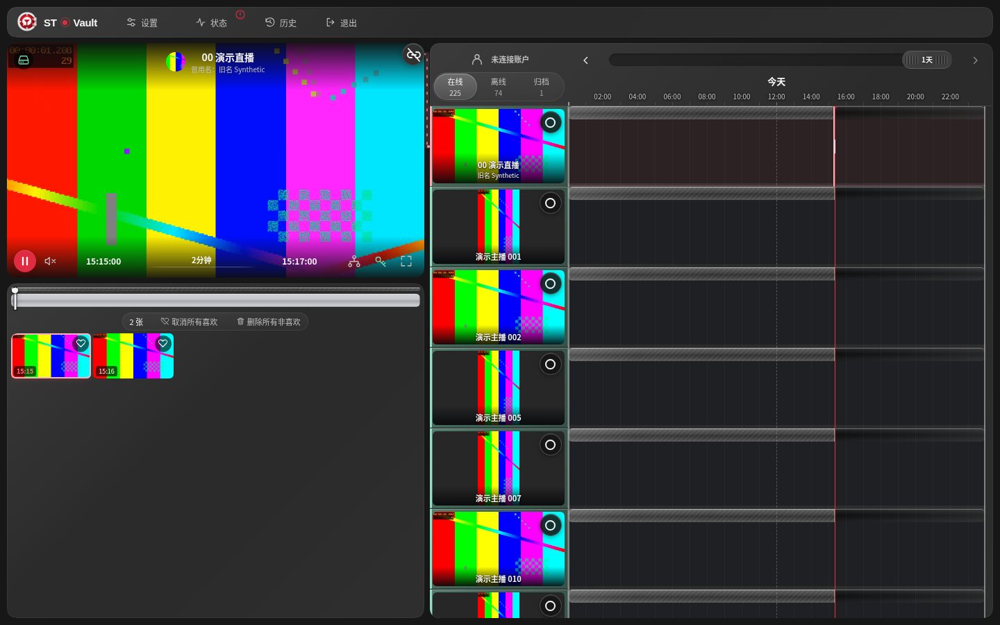
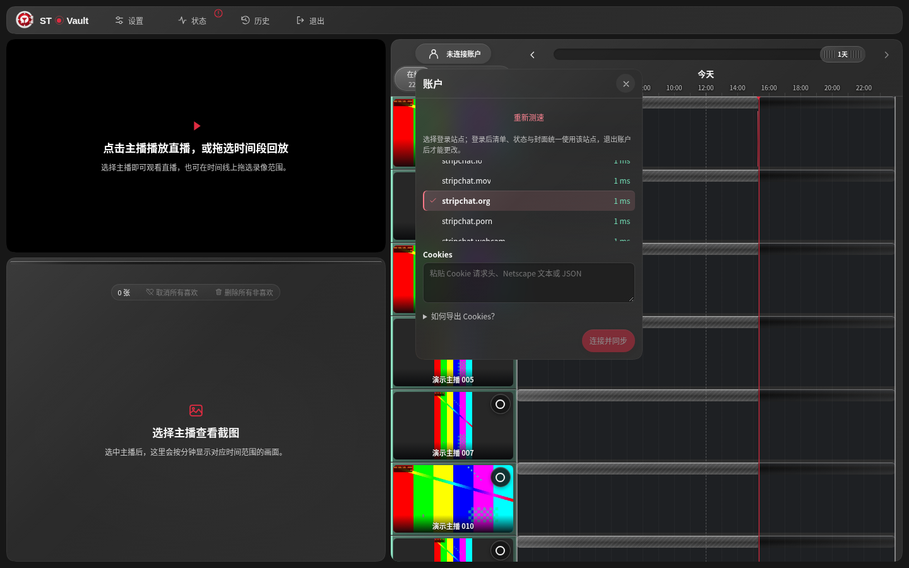
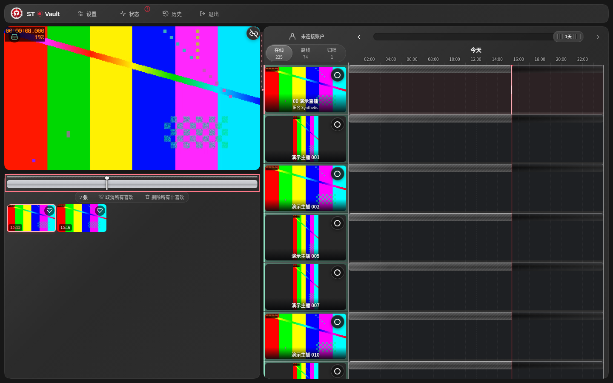
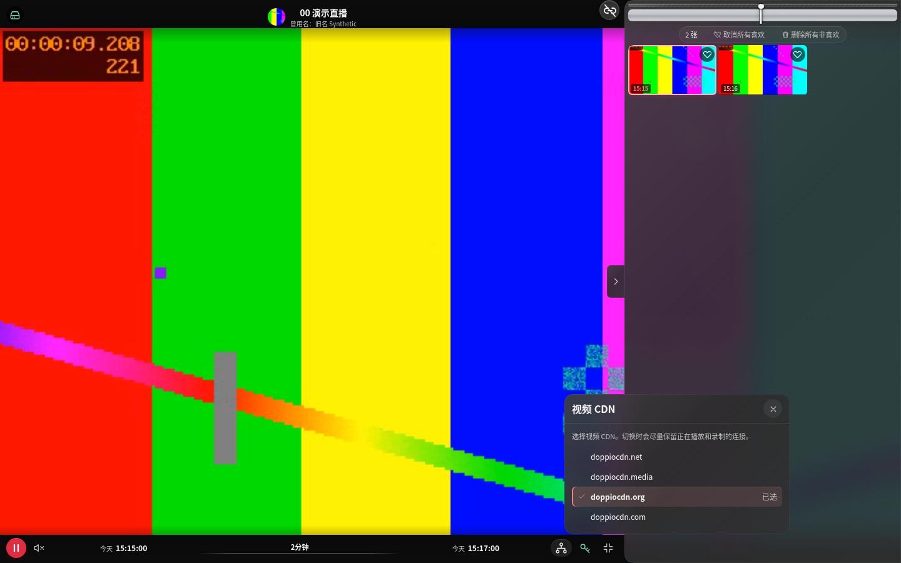
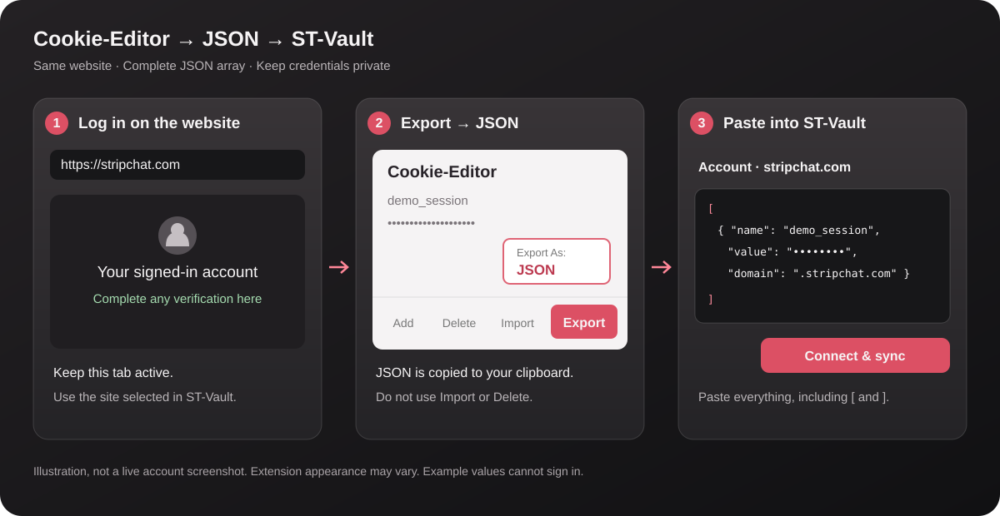

<p align="center">
  
</p>

<h1 align="center">ST-VAULT</h1>

<p align="center"><strong>Your personal live archive</strong></p>
<p align="center">Less scrubbing. More moments worth watching.<br>Record · Replay · Keep</p>

<p align="center"><a href="README.md">简体中文</a> · <strong>English</strong></p>

---

See recent broadcast status, recording coverage and representative images on one timeline. **Find when someone was live, select a recorded range, then use images to jump to the moments that interest you.** Run it on your NAS, watch in your browser and keep your favorites.

[Deploy](#get-started) · [Connect an account](#connect-an-account) · [Get a key](#get-a-key) · [Docker images](https://github.com/tchzhaoge/st-vault/pkgs/container/st-vault)



Screenshots use synthetic test data.

## Find your moments in a full broadcast

**Sync the broadcasters you follow.** Connect your Stripchat following list instead of adding everyone manually. Name changes are recorded automatically, and existing recordings remain browsable after you unfollow.



**Live and replay in the same workspace.** Click a cover to watch a public stream. Enable automatic recording to save the highest available source quality. Select a recorded range and click an image to jump into it; short gaps remain visible, while long gaps are compressed.



**Keep the moments you like.** A heart protects the corresponding complete recording unit from retention cleanup. The toolbar offers “Unlike all” and “Delete unliked” for the entire current time range, including other pages; use each thumbnail’s heart to toggle its favorite. Progress appears in the status panel; refreshing or closing the browser does not cancel accepted deletion jobs.



## Get started

The public image `ghcr.io/tchzhaoge/st-vault:latest` supports **linux/amd64 and linux/arm64**. Docker picks the correct architecture and pulls without a login. Choose either Compose or Docker CLI. Run only one container against a given pair of data directories.

### Option 1: Docker Compose

Save the template as `compose.yml` and run the commands from the same directory. Change the defaults in the template or set the variables in a `.env` file alongside it.

```yaml
name: st-vault
services:
  app:
    image: ${STV_APP_IMAGE:-ghcr.io/tchzhaoge/st-vault:latest}
    user: '0:0'
    init: true
    restart: unless-stopped
    stop_grace_period: 180s
    mem_limit: ${STV_APP_MEMORY:-8g}
    pids_limit: 1024
    shm_size: 128m
    read_only: true
    tmpfs: ['/tmp:size=256m,mode=1777']
    cap_drop: [ALL]
    cap_add: [CHOWN, DAC_OVERRIDE, FOWNER, SETUID, SETGID, KILL]
    security_opt: ['no-new-privileges:true']
    logging:
      driver: json-file
      options: { max-size: '10m', max-file: '3' }
    environment:
      TZ: ${TZ:-Asia/Shanghai}
      STV_RUNTIME_UID: ${STV_UID:-1000}
      STV_RUNTIME_GID: ${STV_GID:-1000}
      STV_SECURE_COOKIE: ${STV_SECURE_COOKIE:-0}
      STV_LOG_DIR: /data/logs
    ports: ['${STV_BIND_ADDRESS:-127.0.0.1}:${STV_RELEASE_PORT:-10002}:10002']
    volumes:
      - ${STV_DATA_VOLUME:-./data}:/data
      - ${STV_MEDIA_VOLUME:-./media}:/media
```

```sh
docker compose pull
docker compose up -d
```

### Option 2: Docker CLI

In a terminal on your NAS or Linux host, go to the directory where you want to keep the deployment and run the following.

```sh
mkdir -p data media
docker pull ghcr.io/tchzhaoge/st-vault:latest
docker run -d --name st-vault --user 0:0 --init --restart unless-stopped \
  --stop-timeout 180 --memory 8g --pids-limit 1024 --shm-size 128m \
  --read-only --tmpfs /tmp:size=256m,mode=1777 \
  --cap-drop ALL --cap-add CHOWN --cap-add DAC_OVERRIDE --cap-add FOWNER \
  --cap-add SETUID --cap-add SETGID --cap-add KILL \
  --security-opt no-new-privileges:true \
  --log-driver json-file --log-opt max-size=10m --log-opt max-file=3 \
  -p 127.0.0.1:10002:10002 \
  -e TZ=Asia/Shanghai -e STV_RUNTIME_UID=1000 -e STV_RUNTIME_GID=1000 \
  -e STV_LOG_DIR=/data/logs \
  --mount "type=bind,src=$(pwd)/data,dst=/data" \
  --mount "type=bind,src=$(pwd)/media,dst=/media" \
  ghcr.io/tchzhaoge/st-vault:latest
```

### Configure your deployment

| Purpose                            | Compose                                | Docker CLI                           | What to change                                                                                                                                                                              |
| ---------------------------------- | -------------------------------------- | ------------------------------------ | ------------------------------------------------------------------------------------------------------------------------------------------------------------------------------------------- |
| Address and port                   | `STV_BIND_ADDRESS`, `STV_RELEASE_PORT` | `-p`                                 | The default allows access from the host only. For a trusted LAN, replace `127.0.0.1` with the NAS's private IP and open `http://NAS-IP:10002`. To change the port, edit only the host side. |
| Time zone                          | `TZ`                                   | `-e TZ=...`                          | Defaults to `Asia/Shanghai`. Use an IANA zone such as `America/New_York`, `Europe/London`, or `UTC`.                                                                                        |
| Database and private configuration | `STV_DATA_VOLUME`                      | First `--mount` source               | Stores the PIN, account configuration, key and PostgreSQL. Use local writable storage, preferably an SSD.                                                                                   |
| Recordings and media library       | `STV_MEDIA_VOLUME`                     | Second `--mount` source              | Stores recordings, screenshots and the portable media library. An absolute path on a larger disk is useful here.                                                                            |
| File ownership                     | `STV_UID`, `STV_GID`                   | `STV_RUNTIME_UID`, `STV_RUNTIME_GID` | Use a non-root UID/GID with write access on the NAS. The default is `1000:1000`.                                                                                                            |
| Version and memory                 | `STV_APP_IMAGE`, `STV_APP_MEMORY`      | Image name, `--memory`               | Use the `:0.1.0` tag to pin the version. Raise the default `8g` limit if you run many concurrent recordings.                                                                                |

The local URL is <http://127.0.0.1:10002>. For access by domain name or public IP, use an HTTPS reverse proxy that preserves the original Host and supports SSE. Set `STV_SECURE_COOKIE=1` to enable Secure session cookies. See the [full Compose file](deploy/compose.yml) and [environment template](deploy/.env.example) for more settings.

Set a six-digit PIN on first visit. Connect an account from the workbench, and import a key before playing an encrypted stream. If a live connection times out, open the player's CDN menu to test actual download speeds and select a node. Changing nodes reconnects all live streams and recordings immediately and may cause a short interruption.

## Connect an account

1. Choose a site in the Account panel, then sign in to the same domain in your browser.
2. Open Cookie-Editor in the signed-in tab and select **Export → JSON**.
3. Paste the full JSON array into the Account panel and select **Connect and sync**. To change domains, disconnect the existing account before importing cookies from the new domain. [Cookie-Editor](https://cookie-editor.com/)



## Get a key

Choose a matching entry in the public key list. Its JSON property name is the `pkey` and its value is the `pdkey`. Open the player's key panel, paste the pair in `pkey:pdkey` format with an ASCII colon, and add it. Upstream keys can rotate, so check the panel's validation result. [Public key list](https://github.com/kesamom/stripchat_mouflon/blob/main/stripchat_mouflon_keys.json) · [Community discussion](https://github.com/lossless1024/StreaMonitor/issues/359)

The key setup draws on two third-party projects. [StripchatRecorder](https://github.com/ChanTrail/StripchatRecorder/blob/master/README.en.md#mouflon-hls-decryption-keys) · [scp-standalone](https://github.com/aitschti/scp-standalone#files)

## Backups, recovery and updates

Stop the container before backing up the complete `data`, `media` and environment configuration. Migrating only `media` can rebuild the media index and requires setting up the PIN, account and key again. Before upgrading, keep a consistent backup and its matching image. [Maintenance guide](docs/CONTRIBUTING.en.md)

## Boundaries

- Only publicly accessible streams are supported. The project does not unlock private/paid content or replace the site's human verification.
- Account access uses cookies exported from your browser; status and media retrieval are anonymous.
- Replay requires locally saved media. Network issues, missing upstream segments and resource constraints can leave gaps that cannot be reconstructed.
- Recordings preserve the source without improving its quality. Screenshots use background software decoding and catch up when queued; there is no GPU dependency.
- One administrator may use multiple clients. A library has one writer instance. Deletion is irreversible; keep backups.

[Architecture and storage](docs/architecture.en.md) · [API](docs/api.en.md) · [Maintenance guide](docs/CONTRIBUTING.en.md)

## Rights and disclaimer

ST-Vault is independent of Stripchat and its operators, with no affiliation or endorsement. Access, save and use only content you are authorized to use, respecting applicable law, site terms, privacy and content rights. Access does not grant redistribution rights.

Original code is licensed under [Apache-2.0](LICENSE); third-party components retain [their own licenses](docs/third-party.en.md). The software is provided as is, without guarantees of uninterrupted operation or protection against data loss. Protect your sessions, access endpoints and backups; see the [security policy](docs/SECURITY.en.md).
