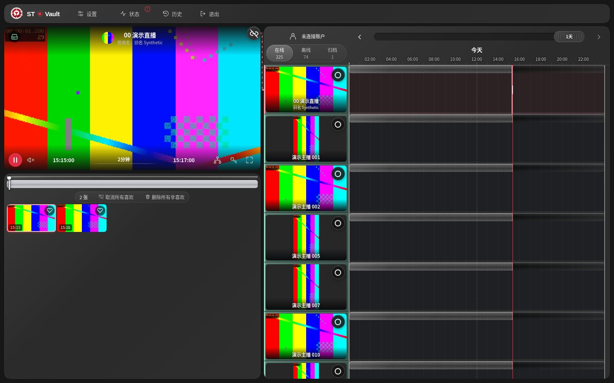
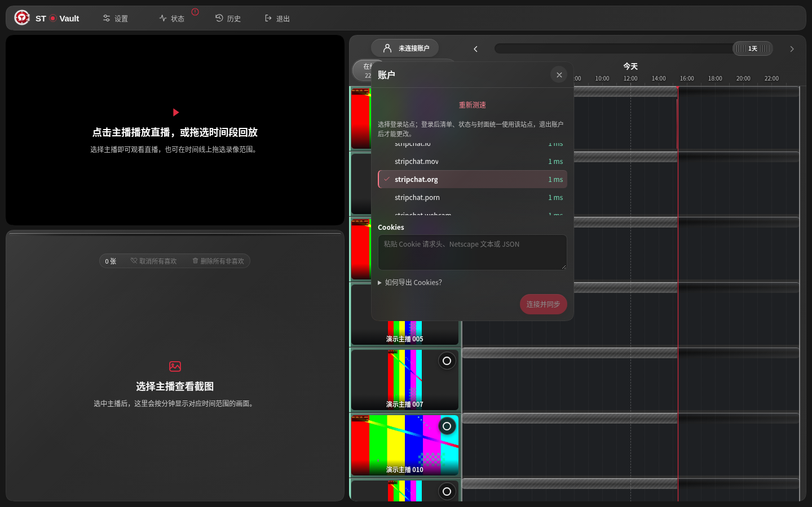
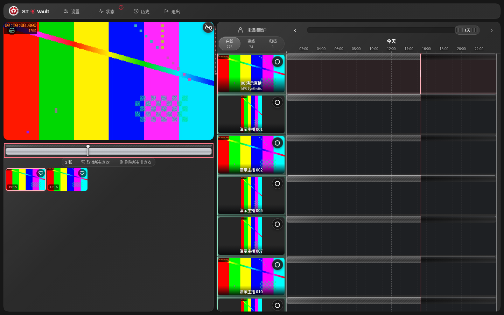
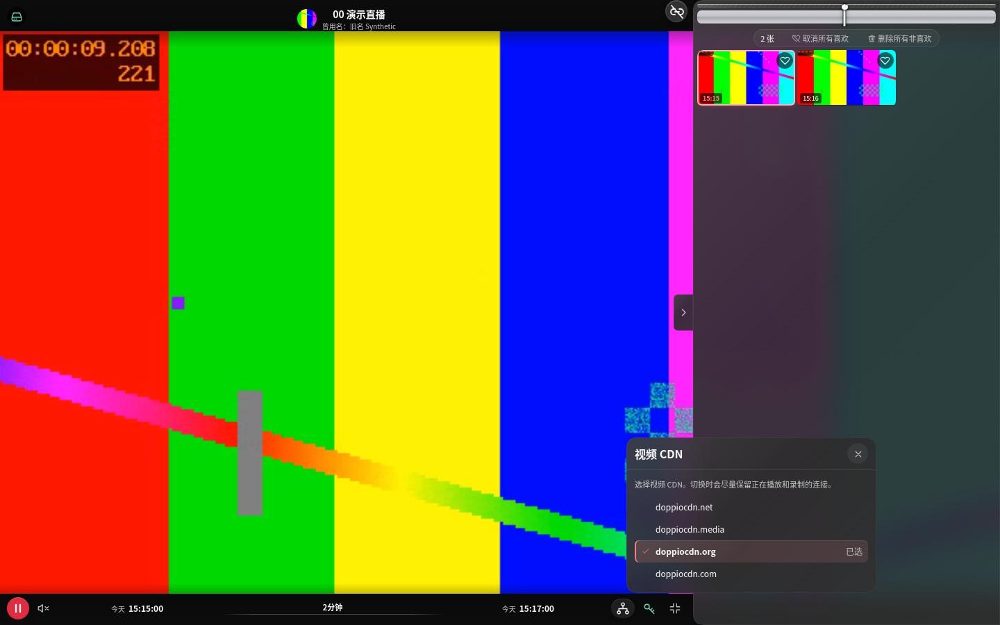
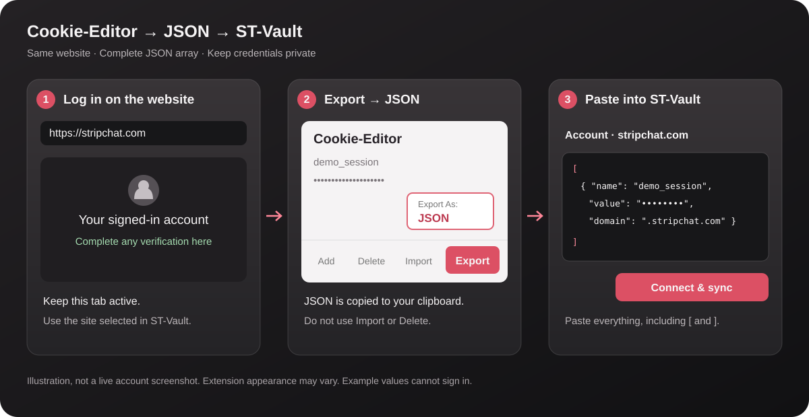

<p align="center">
  
</p>

<h1 align="center">ST-VAULT</h1>

<p align="center"><strong>你的直播时光库</strong></p>
<p align="center">少拖进度条，多看你想看的时刻。<br>记录 · 回看 · 收藏</p>

<p align="center"><strong>简体中文</strong> · <a href="README.en.md">English</a></p>

---

把主播最近的播出状态、录制覆盖和代表截图放在同一张时间线上。**先看什么时候播过，再划出有画面的范围，通过截图定位你感兴趣的高光。** 部署在自己的 NAS，用浏览器看直播、回顾录像，把喜欢的片段留下。

[开始部署](#开始部署) · [连接账户](#连接账户) · [获取密钥](#获取密钥) · [Docker 镜像](https://github.com/tchzhaoge/st-vault/pkgs/container/st-vault)



示例画面使用合成测试数据。

## 从一场直播，找到想看的那一段

**同步喜欢的主播。** 连接 Stripchat 账户的关注列表，免去逐个手动添加。名称变化自动记录曾用名，取关后仍可浏览已有录像。



**直播与回看在同一面板。** 点击封面直接看公开直播，开启自动录制后保存最高可用源画质。拖选录到的范围，再点截图跳到对应画面；短空档留白，长空档压缩，不必反复拖动进度条。



**喜欢的画面长期留下。** 桃心保护对应完整录像单元，不受保留天数清理；截图工具栏直接提供“取消所有喜欢”和“删除所有非喜欢”，均作用于整个当前时间范围（包含其他页）；单张喜欢由桃心切换。运行进度在状态面板查看，刷新或关闭网页不会中断已接纳的删除任务。



## 开始部署

公开镜像 `ghcr.io/tchzhaoge/st-vault:latest` 支持 **linux/amd64 和 linux/arm64**。Docker 会自动选择架构，拉取无需登录。Compose 和 Docker CLI 任选一种，同一组数据目录只供一个容器使用。

### 方式一：Docker Compose

把下面的内容保存为 `compose.yml`，在同一目录执行启动命令。参数可直接改模板中的默认值，也可在同目录的 `.env` 中设置。

```yaml
name: st-vault
services:
  app:
    image: ${STV_APP_IMAGE:-ghcr.io/tchzhaoge/st-vault:latest}
    user: '0:0'
    init: true
    restart: unless-stopped
    stop_grace_period: 180s
    mem_limit: ${STV_APP_MEMORY:-8g}
    pids_limit: 1024
    shm_size: 128m
    read_only: true
    tmpfs: ['/tmp:size=256m,mode=1777']
    cap_drop: [ALL]
    cap_add: [CHOWN, DAC_OVERRIDE, FOWNER, SETUID, SETGID, KILL]
    security_opt: ['no-new-privileges:true']
    logging:
      driver: json-file
      options: { max-size: '10m', max-file: '3' }
    environment:
      TZ: ${TZ:-Asia/Shanghai}
      STV_RUNTIME_UID: ${STV_UID:-1000}
      STV_RUNTIME_GID: ${STV_GID:-1000}
      STV_SECURE_COOKIE: ${STV_SECURE_COOKIE:-0}
      STV_LOG_DIR: /data/logs
    ports: ['${STV_BIND_ADDRESS:-127.0.0.1}:${STV_RELEASE_PORT:-10002}:10002']
    volumes:
      - ${STV_DATA_VOLUME:-./data}:/data
      - ${STV_MEDIA_VOLUME:-./media}:/media
```

```sh
docker compose pull
docker compose up -d
```

### 方式二：Docker CLI

在 NAS / Linux 的终端进入准备用于部署的目录，执行以下命令。

```sh
mkdir -p data media
docker pull ghcr.io/tchzhaoge/st-vault:latest
docker run -d --name st-vault --user 0:0 --init --restart unless-stopped \
  --stop-timeout 180 --memory 8g --pids-limit 1024 --shm-size 128m \
  --read-only --tmpfs /tmp:size=256m,mode=1777 \
  --cap-drop ALL --cap-add CHOWN --cap-add DAC_OVERRIDE --cap-add FOWNER \
  --cap-add SETUID --cap-add SETGID --cap-add KILL \
  --security-opt no-new-privileges:true \
  --log-driver json-file --log-opt max-size=10m --log-opt max-file=3 \
  -p 127.0.0.1:10002:10002 \
  -e TZ=Asia/Shanghai -e STV_RUNTIME_UID=1000 -e STV_RUNTIME_GID=1000 \
  -e STV_LOG_DIR=/data/logs \
  --mount "type=bind,src=$(pwd)/data,dst=/data" \
  --mount "type=bind,src=$(pwd)/media,dst=/media" \
  ghcr.io/tchzhaoge/st-vault:latest
```

### 按部署环境修改参数

| 用途             | Compose                                | Docker CLI                           | 如何调整                                                                                                                      |
| ---------------- | -------------------------------------- | ------------------------------------ | ----------------------------------------------------------------------------------------------------------------------------- |
| 访问地址和端口   | `STV_BIND_ADDRESS`、`STV_RELEASE_PORT` | `-p`                                 | 默认仅本机可访问。可信局域网可将 `127.0.0.1` 改为 NAS 的私有 IP，使用 `http://NAS的IP:10002` 访问。修改端口时只改宿主机一侧。 |
| 时区             | `TZ`                                   | `-e TZ=...`                          | 默认 `Asia/Shanghai`。可改为 `Asia/Tokyo`、`America/New_York` 或其他 IANA 时区。                                              |
| 数据库和私有配置 | `STV_DATA_VOLUME`                      | 第一个 `--mount` 的 `src`            | 保存 PIN、账户配置、密钥和 PostgreSQL。使用本机可写磁盘，优先 SSD。                                                           |
| 录像和媒体库     | `STV_MEDIA_VOLUME`                     | 第二个 `--mount` 的 `src`            | 保存录像、截图和可迁移媒体库。建议指定大容量磁盘上的绝对路径。                                                                |
| 文件读写身份     | `STV_UID`、`STV_GID`                   | `STV_RUNTIME_UID`、`STV_RUNTIME_GID` | 按 NAS 上有权限的非 root UID/GID 配置，默认 `1000:1000`。                                                                     |
| 版本和内存       | `STV_APP_IMAGE`、`STV_APP_MEMORY`      | 镜像名、`--memory`                   | 用 `:0.1.0` 固定版本。多路并发录制可按需提高默认的 `8g` 内存上限。                                                            |

本机默认访问 <http://127.0.0.1:10002>。通过域名或公网 IP 访问时使用 HTTPS 反向代理，保留原始 Host 并支持 SSE。将 `STV_SECURE_COOKIE` 设为 `1` 以启用 Secure 会话 Cookie。更多配置见[完整 Compose 模板](deploy/compose.yml)和[环境变量模板](deploy/.env.example)。

首次打开时设置六位 PIN。进入工作台后可连接账户，播放加密直播前需导入密钥。直播连接超时时，可在播放器的 CDN 菜单手动测速并选择节点。测速会下载小段媒体作比较。更换节点会让所有直播和录制立即重新连接，期间可能短暂停顿。

## 连接账户

1. 在账户面板选择站点，然后在浏览器登录同一域名。
2. 在已登录的标签页打开 Cookie-Editor，选择 **Export → JSON**。
3. 将完整 JSON 数组粘贴到 ST-Vault 账户面板，点击「连接并同步」。换域名时先断开旧账户，再导入新域名的 Cookies。[Cookie-Editor](https://cookie-editor.com/)



## 获取密钥

从公开密钥列表选择匹配的条目。JSON 属性名是 `pkey`，对应值是 `pdkey`。打开播放器钥匙面板，将一对密钥按 `pkey:pdkey` 格式粘贴并添加，中间使用英文冒号。上游会轮换密钥，请以面板验证结果为准。[公开密钥列表](https://github.com/kesamom/stripchat_mouflon/blob/main/stripchat_mouflon_keys.json) · [社区讨论](https://github.com/lossless1024/StreaMonitor/issues/359)

密钥配置参考了两个第三方项目。[StripchatRecorder](https://github.com/ChanTrail/StripchatRecorder/blob/master/README.en.md#mouflon-hls-decryption-keys) · [scp-standalone](https://github.com/aitschti/scp-standalone#files)

## 备份恢复与更新

停止容器后备份完整的 `data`、`media` 和环境配置。只迁移 `media` 可以重建媒体索引，PIN、账户和密钥需重新配置。更新前保留同一停写时点的备份及对应镜像。[维护说明](docs/CONTRIBUTING.md)

## 使用边界

- 只访问和保存公开可用直播，不解锁私密/付费内容，不代替原站真人验证。
- 账户通过用户浏览器导出的 Cookies 接入；状态和媒体匿名获取。
- 只能回看本地已保存画面，网络、上游缺片、资源不足可能留下空档，无法补回不存在的内容。
- 原流保存，不提升源画质；截图后台软件解码，积压时继续追赶，没有 GPU 依赖。
- 单管理员、多客户端；数据目录由单实例独占，删除不可撤销，请备份。

[架构与存储](docs/architecture.md) · [API](docs/api.md) · [维护说明](docs/CONTRIBUTING.md)

## 权利与免责声明

本项目与 Stripchat 及其运营方无隶属或背书关系。请仅访问、保存和使用已获授权的内容，遵守适用法律、网站条款及相关人员的隐私与内容权利；能够访问不代表可以转载或分发。

原创代码采用 [Apache-2.0](LICENSE)，第三方组件遵循[各自许可](docs/third-party.md)。软件按现状提供，不保证不中断或数据不丢失。会话、访问入口和备份由部署者妥善管理，详见[安全说明](docs/SECURITY.md)。
